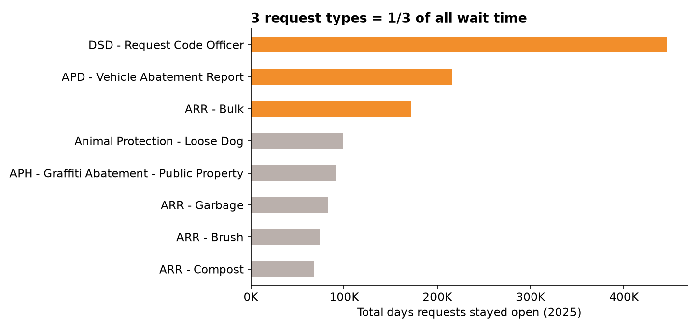
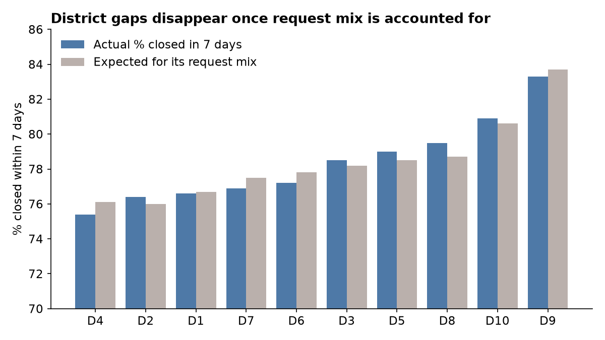

# Austin 311: Where Requests Wait, and Is Service Equal Across Districts?

**Question:** Austin residents filed almost 300,000 311 requests in 2025. How fast does the city close them, which request types hold up the most residents, and do some council districts get slower service than others?

**Data:** Real, public [Austin 311 Public Data](https://data.austintexas.gov/Utilities-and-City-Services/Austin-311-Public-Data/xwdj-i9he) from the City of Austin open data portal. All requests created Jan 1 - Dec 31, 2025: 298,920 rows (12 test records removed). Pulled October 2026.

**Tools:** SQL (SQLite) for cleaning and analysis, Tableau for the dashboard.

---

## Key findings

1. **Most requests close fast, but the tail is long.** Median time to close is 1.1 days and 78.6% close within 7 days. But the slowest 10% take 20+ days, and 6.4% take over a month.

2. **Three request types hold 34.5% of all waiting time while making up only 14.8% of requests:** Code Officer requests (Development Services), Vehicle Abatement reports (Police) and Bulk item pickup (Resource Recovery). Vehicle Abatement is the slowest high-volume type: median 19.8 days, only 19.7% closed within a week.



3. **District gaps are about request mix, not unequal service.** Raw on-time rates range from 75.4% (District 4) to 83.3% (District 9), almost 8 points apart. But after comparing each district to what it should get based on the types of requests it files, every district lands within 1 point of expected. District 9 files more quick-to-close requests; District 4 files more slow ones.



4. **The source data splits departments in two.** Around September 2025 the city renamed most departments ("Austin Police Department" became "Austin Police", etc.). 31 department names collapse to 15 real departments. Without fixing this, any department report would show each team at about half its real volume.

5. **Old open requests sit in one department.** 1,697 requests from 2025 were still open when I pulled the data. 1,034 of them (61%) belong to Development Services, averaging over a year old.

## Recommendations

- Focus improvement on Vehicle Abatement and Code Officer requests. Together they hold 27% of all resident wait time.
- Report equity using the mix-adjusted method (actual vs. expected), not raw averages. Raw numbers would wrongly point to District 4 as underserved.
- Add a department mapping table to the city's reporting layer so dashboards are not broken by future renames.
- Review the 1,034 old Development Services requests: close stale ones, or add a status that shows they are waiting on the resident.

## How I did it

| Step | File | What it does |
|---|---|---|
| 1 | `sql/01_load.sql` | Imports the 2025 CSV into SQLite |
| 2 | `sql/02_clean.sql` | Parses dates, calculates days to close, flags duplicates, builds a department mapping table for the rename |
| 3 | `sql/00_data_checks.sql` | Duplicate IDs, status mix, negative durations, missing district |
| 4 | `sql/03_analysis.sql` | Citywide KPIs, department and request type scorecards (median and 90th percentile), channel mix, district equity, open backlog |
| 5 | `sql/04_export.sql` | Writes aggregated CSVs for Tableau |

SQL concepts used: date math with `julianday()`, window functions for median and 90th percentile, a lookup table with `INSERT ... VALUES` and a correlated subquery `UPDATE`, CTEs, and indirect standardization (expected vs. actual) with a join back to a citywide rate.

**Data quality notes**
- No duplicate request numbers and no requests closed before they were opened.
- 2.7% of requests have no council district (outside city limits or no address). Excluded from the district analysis only.
- 2.7% are marked duplicate. Excluded from response time, kept in volume counts.
- Days to close is calendar days from creation to the close date the city recorded. It does not show when work actually happened.

## Run it yourself

The raw file is gzipped to stay under GitHub's size limit.

```bash
gunzip -k data/austin311_2025.csv.gz
sqlite3 austin311.db < sql/01_load.sql
sqlite3 austin311.db < sql/02_clean.sql
sqlite3 austin311.db < sql/00_data_checks.sql
sqlite3 austin311.db < sql/03_analysis.sql
sqlite3 austin311.db < sql/04_export.sql
```

Or pull a fresh copy from the [city's API](https://data.austintexas.gov/resource/xwdj-i9he.csv) with the date filter in `sql/01_load.sql`.

README charts are made by `charts.py` (pandas + matplotlib) from the output CSVs.

Tableau dashboard: see [tableau/README.md](tableau/README.md)

## Limitations

- 2025 only. Seasonality and year-over-year change are not covered.
- Some request types close when routed to another system, so a fast close is not always a fast fix.
